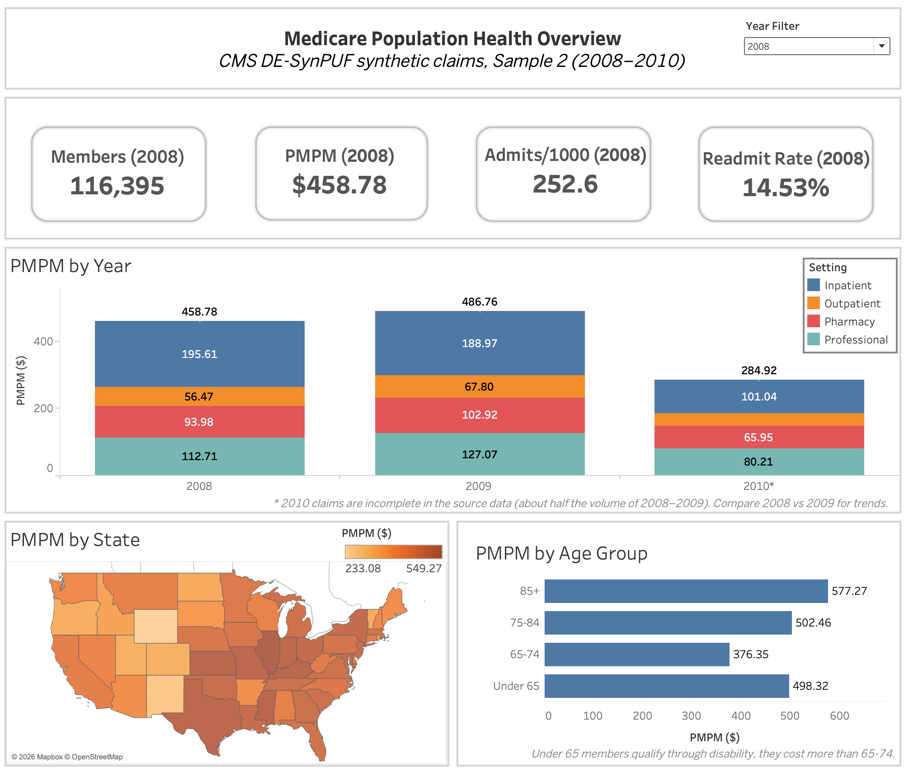

# Medicare Claims Analytics

Population health and cost-risk analysis of CMS synthetic Medicare claims (about 116,000 members, 2008–2010).

**[View the interactive dashboards on Tableau Public](https://public.tableau.com/app/profile/ritesh.kc/viz/MedicareClaimsAnalytics/MedicareClaimAnalytics)**



## Key findings

- **Costs rose 6% from 2008 to 2009** ($459 to $487 per member per month), driven by outpatient, doctor, and pharmacy spending.
- **More conditions, much higher cost.** Members with 5+ chronic conditions cost over 10 times more per month than members with none.
- **Kidney disease, COPD, and stroke** carry the biggest cost gaps, about 3 times the cost of members without them.
- **A small group drives next year's cost.** The model's top 20% of members account for 47% of the following year's spending.
- **The risk model beats the usual benchmark** (AUC 0.83 vs 0.80 for ranking by last year's cost). 22 of its 25 highest-risk members were actually high-cost.

## What's inside

| Notebook | What it does |
|---|---|
| 01_download_data | Downloads the CMS data |
| 02_load_duckdb | Loads it into a DuckDB database |
| 03_population_health | Cost (PMPM), hospital admissions, readmissions, chronic conditions |
| 04_coding_analysis | Top diagnoses (ICD-9), procedures, and doctor services (CPT/HCPCS) |
| 05_risk_model | Predicts next year's high-cost members (scikit-learn) |
| 06_export_powerbi | Exports tables for the dashboards |

**Tools:** Python, SQL (DuckDB), scikit-learn, Tableau

## Run it

```bash
python3 -m venv venv
source venv/bin/activate
pip install -r requirements.txt
jupyter lab
```

Then run the notebooks in order. Notebook 01 downloads about 3 GB.

## Limitations

- The data is **synthetic**, so results show methods, not real patients.
- **2010 claims are incomplete** in the source data, so trends compare 2008 and 2009.
